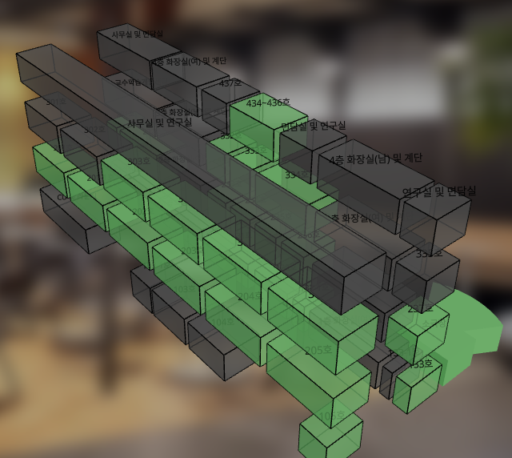

# AJOU SIGNAGE

### 3D 기반 캠퍼스 강의실 탐색 및 예약 사이니지 시스템

> **제2회 아주톤(AJOU Hackathon) · 아주대학교 성호관의 공간 탐색부터 강의실 예약까지 연결한 웹 프로토타입**



## 아키텍처

**공간 데이터 → 3D 탐색 → 예약 → 사용 현황 조회**를 하나의 사용자 흐름으로 연결했습니다. 아래는 이 저장소의 **프런트엔드 구현**을 기준으로 정리한 구성도입니다.

```text
[사용자 / 전자칠판 / 모바일 브라우저]
                  |
                  v
              main.tsx
       예약·강의 IndexedDB 초기화
                  |
                  v
          App.tsx + useDeviceType
                  |
          +-------+------------------------------+
          |                                      |
          v                                      v
  [Desktop: 1024px 이상]               [Mobile / Tablet: 1024px 미만]
  BuildingViewer                      ClassroomManagement
          |                                      |
          +-- 전체 건물 표시                     +-- 검색·건물·층·상태 필터
          +-- FloorViewer: 선택한 층              +-- StatusView: 사용 현황
          +-- RoomComponent: 방 메시·상태 색상    +-- ScheduleView: 시간표
          |                                      +-- ReservationView: 예약 관리
          v                                      |
  RoomReservationModal                           v
          |                               ReservationForm
          +------------------+-------------------+
                             |
                             v
                  reservationDB.ts
                충돌 조회 / 예약 CRUD
                             |
                             v
                   [브라우저 IndexedDB]
                 예약: RoomReservationDB
                 강의: LectureDB
```

**데이터와 보조 기능의 연결**

```text
공간 정의: types/building.ts + data/{seong,paldal,dasan}Data.ts
    +--> BuildingViewer / FloorViewer / RoomComponent: 3D 배치
    +--> classroomData.ts: 현황 목록 생성

예약·강의: reservationDB.ts / lectureDB.ts --> IndexedDB
    +--> RoomComponent.tsx: 3D 방의 사용 상태 계산
    +--> classroomData.ts: 목록 상태·다음 일정 계산
    +--> scheduleData.ts: 날짜별 시간표 구성

시간: 외부 시간 API --> timeService.ts --> 상태·일정 계산
                         +-- 캐시 / 실패 시 로컬 시간 대체

변경 알림: 예약 폼·관리 화면 --> eventBus.ts
                                  +--> 구독 중인 예약·시간표 화면 재조회

인증: 인증 UI --> passkeyAuth.ts --> WebAuthn / 기기 인증기
                       +----------> localStorage: 사용자 정보·세션

배포: Docker(Node + Vite 빌드) --> 정적 파일 --> Nginx --> 브라우저
```

화살표는 호출·데이터 전달 관계를 요약합니다. 3D 화면과 목록 화면의 상태 계산은 **현재 서로 다른 코드 경로**이며, 위 그림에서 하나의 공통 계산 서비스로 합쳐 표현하지 않았습니다.

**배포 구성:** Docker의 Node 빌드 단계에서 정적 파일을 생성하고, Nginx가 SPA를 제공하도록 구성했습니다. 현재 저장소에는 예약 서버 API와 중앙 데이터베이스 연결 구현이 포함되어 있지 않습니다. 기존 소개에 기재된 **FastAPI·SQLAlchemy·PostgreSQL은 이 코드의 실행 구성으로 확인되지 않아 위 다이어그램에서 제외**했습니다.

| 구현 포인트 | 설계에서 확인할 수 있는 점 | 코드 |
| --- | --- | --- |
| 데이터 기반 3D 구성 | 공간의 크기·위치를 렌더링 코드에서 분리하고 사각형·부채꼴 방을 타입으로 구분 | [공간 타입](src/types/building.ts), [성호관 데이터](src/data/seongData.ts) |
| 기기별 화면 구성 | 데스크톱 공간 탐색과 모바일·태블릿 현황 화면을 분리 | [앱 진입점](src/App.tsx), [화면 분기 훅](src/hooks/useDeviceType.ts) |
| 저장소 접근 분리 | IndexedDB 초기화·인덱스 조회·예약 CRUD를 모듈로 캡슐화 | [예약 저장소](src/utils/reservationDB.ts), [강의 저장소](src/utils/lectureDB.ts) |
| 변경 후 화면 갱신 | 예약 목록·시간표 화면에서 이벤트를 구독하고 해제 | [이벤트 버스](src/utils/eventBus.ts), [예약 관리](src/components/common/ReservationView.tsx) |

## 핵심 로직

### 1. 공간 데이터를 3D 강의실로 변환

[BuildingViewer](src/components/desktop/BuildingViewer.tsx)는 층 목록을 순회하면서 **층 높이와 층간 간격을 누적**해 배치합니다. 각 방은 [RoomComponent](src/components/RoomComponent.tsx)가 위치·크기·형상에 맞는 Three.js 메시로 표현합니다. 층 선택은 [FloorViewer](src/components/desktop/FloorViewer.tsx)로, 방 클릭은 해당 방의 예약 모달로 연결합니다.

- **공간 모델:** <code>Building → Floor[] → Room[]</code> 계층으로 건물 정보를 표현합니다.
- **형상 모델:** <code>Room = BoxRoom | SectorRoom</code>으로 사각형과 부채꼴에 필요한 속성을 구분합니다.
- **사용자 조작:** React Three Fiber와 Drei의 Canvas, OrbitControls로 회전·확대·이동을 제공합니다.

### 2. 예약 시간의 겹침을 검사한 뒤 저장

예약 화면은 필수값을 확인하고, [checkTimeConflict](src/utils/reservationDB.ts)로 **같은 강의실·같은 날짜의 기존 예약**을 조회합니다. 시작 시간과 사용 시간으로 종료 시간을 계산한 후 겹치는 예약을 반환합니다. 아래는 실제 구현의 세 가지 겹침 조건을 하나로 표현한 판정식입니다.

~~~ts
// 예약 구간 [start, end): 앞 예약의 종료와 다음 시작이 같으면 허용
const overlaps = newStart < existingEnd && existingStart < newEnd;
~~~

**10:00–11:00 예약이 있으면 10:30 시작은 충돌, 11:00 시작은 허용**합니다. 검사 통과 후 IndexedDB에 저장하고, 모바일·태블릿 예약 폼은 <code>reservationUpdated</code> 이벤트로 구독 화면의 재조회를 유도합니다. 수정 시에는 자기 자신의 예약을 충돌 대상에서 제외합니다.

현재 검사는 브라우저에 저장된 예약을 대상으로 합니다. 서버 트랜잭션으로 여러 사용자 간 중복 예약을 방지하는 구조까지 구현된 것은 아닙니다.

관련 코드: [예약 폼](src/components/reservation/ReservationForm.tsx) · [3D 예약 모달](src/components/RoomReservationModal.tsx) · [예약 수정](src/components/common/ReservationView.tsx)

### 3. 예약과 정규 강의를 합쳐 사용 현황 계산

[classroomData](src/data/classroomData.ts)는 예약·강의를 <code>Promise.all</code>로 읽고 현재 상태와 다음 일정을 계산합니다.

1. 현재 시간이 예약 구간에 포함되면 <code>occupied</code>로 판정합니다.
2. 예약이 없으면 오늘의 요일에 해당하는 정규 강의를 확인합니다.
3. 진행 중인 일정이 없으면 <code>available</code>로 판정합니다.
4. 남은 예약과 강의 시작 시각을 비교해 가장 가까운 다음 일정을 표시합니다.

목록 데이터에는 **30초 캐시**, 관리 화면에는 **30초 주기 조회**와 수동 새로고침이 있습니다. [timeService](src/utils/timeService.ts)는 외부 시간 API를 순서대로 시도하고 **1분 캐시와 마지막 시간 오프셋**을 활용하며, API 실패 시 로컬 시간으로 대체합니다.

3D 방 색상과 목록 상태 계산은 각각 구현되어 공통 함수로 통합할 여지가 있습니다. **사용 인원은 임시 난수, 수용 인원은 임시 상수**이며 실제 센서 측정값이 아닙니다.

### 4. Passkey 등록·인증 경험 연결

[passkeyAuth](src/utils/passkeyAuth.ts)는 브라우저의 <code>navigator.credentials.create()</code>와 <code>navigator.credentials.get()</code>으로 기기 인증기를 사용하는 흐름을 구현했습니다. 사용자 메타데이터와 인증 상태는 localStorage에 보관하고, 인증 후 표시 이름을 예약 입력에 활용합니다.

현재는 **브라우저 내 인증 경험을 시연하는 구현**입니다. 서버 발급 challenge와 assertion 서명 검증, 예약 소유권·권한 확인까지 갖춘 운영용 인증 시스템은 아닙니다.

## 프로젝트 소개

AJOU SIGNAGE는 기존 대학 포털의 여러 조회 단계를 **공간 탐색 중심의 인터페이스**로 바꾸기 위해 기획했습니다. 성호관을 3D로 표현하고, 층과 강의실을 선택해 일정과 예약을 확인하도록 구성했습니다. 전자칠판에서는 터치 기반 공간 안내와 예약 화면을 제공하는 사이니지 사용 시나리오를 시연했습니다.

| 사용자 문제 | 구현한 접근 |
| --- | --- |
| 강의실 위치를 목록만으로 파악하기 어려움 | 건물 전체·층별 3D 탐색과 강의실 선택 |
| 사용 가능한 강의실을 찾기 위한 반복 조회 | 건물·층·이름·상태 필터와 현황 카드 |
| 공간 조회와 예약 입력이 분리됨 | 선택한 방의 일정 조회와 예약 모달 연결 |
| 화면 크기와 이용 환경이 다양함 | 데스크톱 3D, 모바일·태블릿 현황 UI 분리 |

시연 당시 주소: https://pass.kksoft.kr:5173/ — 현재 서비스 미운영.

## 기술 스택

| 구분 | 이 저장소의 구현 |
| --- | --- |
| 언어·UI | TypeScript, React 19, React Bootstrap, CSS Modules |
| 빌드 도구 | Vite, SWC |
| 3D 시각화 | Three.js, React Three Fiber, Drei |
| 브라우저 저장소 | IndexedDB: 예약·강의 / localStorage: 사용자·세션 |
| 인증 인터페이스 | WebAuthn / Passkey |
| 화면 갱신 | React state·effect, 이벤트 버스, 주기 조회 |
| 컨테이너 구성 | Docker 다단계 빌드, Nginx 정적 파일 제공 |

## 디렉토리 구조와 역할

아래는 실제 파일을 확인해 정리한 주요 디렉토리입니다. 의존성·빌드 산출물·편집기 이력과 일부 보조 파일은 생략했습니다.

```text
Ajou-Signage/
├── src/                              # 애플리케이션 소스
│   ├── main.tsx                      # DB 초기화 후 React 렌더링
│   ├── App.tsx                       # 기기별 화면 분기·선택한 층 상태
│   ├── App.css / index.css           # 앱·전역 스타일
│   │
│   ├── components/                   # 화면과 상호작용 컴포넌트
│   │   ├── desktop/
│   │   │   ├── BuildingViewer.tsx     # 건물 전체 3D 탐색·예약 연결
│   │   │   └── FloorViewer.tsx        # 선택한 층의 3D 탐색
│   │   ├── mobile/                   # 모바일 헤더·하단 메뉴·카드·통계
│   │   ├── tablet/                   # 태블릿 하단 메뉴·콘텐츠 컴포넌트
│   │   ├── common/
│   │   │   ├── StatusView.tsx         # 강의실 현황과 상세 화면 연결
│   │   │   ├── ScheduleView.tsx       # 시간표 조회·예약 폼 연결
│   │   │   ├── ReservationView.tsx    # 예약 목록·수정·삭제
│   │   │   ├── SettingsView.tsx       # 설정·사용자 정보
│   │   │   ├── Sidebar.tsx           # 건물·층·상태 필터 UI
│   │   │   └── Layout.tsx            # 현재 내용이 없는 파일
│   │   ├── reservation/
│   │   │   ├── ReservationForm.tsx    # IndexedDB 기반 예약 입력
│   │   │   └── ReservationList.tsx    # 별도 메모리 예약 모델을 참조하는 목록
│   │   ├── RoomComponent.tsx          # 방 형상·상태 색상·클릭 처리
│   │   ├── RoomReservationModal.tsx   # 3D 화면에서 사용하는 예약 모달
│   │   ├── PasskeyRegistrationModal.tsx
│   │   ├── QuickAuthModal.tsx         # 인증 관련 화면
│   │   └── AppHeader.tsx / Footer.tsx # 앱 헤더·층 선택 메뉴
│   │
│   ├── pages/
│   │   └── ClassroomManagement.tsx   # 모바일·태블릿 탭·필터·조회 상태 관리
│   ├── hooks/
│   │   └── useDeviceType.ts          # 화면 너비에 따른 기기 유형 판별
│   │
│   ├── data/
│   │   ├── seongData.ts              # 성호관 공간·형상 정의
│   │   ├── paldalData.ts             # 팔달관 공간·형상 정의
│   │   ├── dasanData.ts              # 다산관 공간·형상 정의
│   │   ├── buildingData.ts           # 건물 목록·이름 매핑
│   │   ├── classroomData.ts          # 예약·강의를 조합한 현황 계산·캐시
│   │   ├── scheduleData.ts           # 시간 슬롯·날짜별 일정 생성
│   │   └── reservationData.ts        # 메모리 배열 기반 별도 예약 구현
│   │
│   ├── types/
│   │   ├── building.ts               # Building·Floor·Room·저장소 예약 타입
│   │   ├── reservation.ts            # classroomId/startTime 기반 별도 예약 타입
│   │   ├── classroom.ts              # 현황 카드·통계 타입
│   │   ├── schedule.ts               # 시간 슬롯·일정 타입
│   │   ├── Lecture.ts                # 정규 강의 타입
│   │   └── auth.ts                   # 사용자·세션·QR 인증 타입
│   │
│   ├── utils/
│   │   ├── reservationDB.ts          # 예약 IndexedDB 접근·시간 충돌 조회
│   │   ├── lectureDB.ts              # 강의 IndexedDB 접근·샘플 초기화
│   │   ├── timeService.ts            # 외부 시간 조회·캐시·대체 처리
│   │   ├── timeFormat.ts             # 날짜 문자열 변환
│   │   ├── passkeyAuth.ts            # WebAuthn 호출·브라우저 세션 관리
│   │   ├── qrCode.ts                 # QR 데이터 생성·파싱
│   │   └── eventBus.ts               # 화면 간 이벤트 발행·구독
│   ├── styles/                       # common·desktop·mobile·tablet 스타일
│   └── assets/                       # 소스에서 사용할 정적 자원
│
├── public/                           # 배경 이미지 등 정적 제공 파일
├── images/                           # README 시연 이미지
├── pdf_files/                        # 발표 자료
├── index.html                        # Vite 앱 진입 HTML
├── demo.html                         # 별도 데모 HTML
├── package.json / package-lock.json  # 스크립트·의존성과 버전 잠금
├── vite.config.ts                    # 개발 서버·번들러 설정
├── tsconfig*.json / eslint.config.js # TypeScript·정적 검사 설정
├── Dockerfile / docker-compose.yml   # 정적 앱 컨테이너 구성
├── nginx.conf                        # 정적 파일·SPA 제공 설정
├── PASSKEY_SETUP.md                  # Passkey 설정 안내
└── README.md / README.docker.md       # 프로젝트·실행 문서
```

### 디렉토리를 읽는 방법

| 영역 | 현재 책임 | 구조 분석 |
| --- | --- | --- |
| <code>pages/</code> | 페이지 수준 상태와 여러 화면의 조합 | 필터·탭·조회 상태의 중심이 명확함. 조회 로직은 전용 훅으로 분리할 여지가 있음 |
| <code>components/</code> | 렌더링과 사용자 상호작용 | 기기별 분리와 기능별 분리를 함께 사용함. <code>common/</code>은 단순 공통 UI뿐 아니라 예약·시간표 기능도 포함 |
| <code>data/</code> | 공간 상수, 상태·일정 계산, 별도 예약 배열 | 정적 데이터와 업무 로직이 섞여 있음. 공간 정의와 계산 함수를 분리하면 탐색하기 쉬움 |
| <code>types/</code> | 데이터 계약 | 방 형상 타입 구분은 명확함. 예약 타입은 두 종류이므로 표준 모델로 통합할 필요가 있음 |
| <code>utils/</code> | 저장소·시간·인증·이벤트 | 화면에서 공통 기능을 분리한 점은 좋음. 저장소와 서비스의 역할을 폴더로 더 구분할 수 있음 |
| <code>styles/</code> | 공통·기기별 스타일 | 화면 컴포넌트의 기기 구분과 대응하므로 관련 스타일을 찾기 쉬움 |

### 예약 데이터 경로가 두 종류인 점

```text
현재 주요 예약 입력·조회 경로
  ReservationForm / RoomReservationModal / ReservationView
       --> utils/reservationDB.ts
       --> IndexedDB
       --> types/building.ts의 Reservation
           (roomId, time, duration)

별도 예약 모델을 참조하는 컴포넌트 코드
  MobileClassroomCard / ReservationList
       --> data/reservationData.ts
       --> 메모리 배열
       --> types/reservation.ts의 Reservation
           (classroomId, startTime, endTime)
```

두 경로는 저장 위치와 데이터 형식이 다릅니다. 두 번째 경로의 컴포넌트가 현재 메인 화면에 모두 연결되어 있다는 뜻은 아니며, **파일의 import 관계에서 확인한 별도 구현**입니다. 기능 확장 시 예약 모델과 저장소 접근을 한 경로로 정리하면 화면 간 불일치를 줄일 수 있습니다.

**전체 구조 판단:** 역할별 폴더 구분은 되어 있지만 엄격한 계층형 구조는 아닙니다. 화면에서 저장소를 직접 호출하고 <code>data/</code>에서도 업무 계산을 수행하는 형태입니다. 기존 폴더 구성을 유지하면서 상태 계산·예약 모델·저장소 접근을 공통화하는 방향이 적합합니다.

## 실행 방법

~~~bash
npm ci
npm run dev
~~~

개발 서버는 http://localhost:5173 에서 실행합니다. Passkey 사용에는 이를 지원하는 브라우저와 기기 인증 환경이 필요합니다.

~~~bash
npm run build    # TypeScript 검사 후 Vite 빌드
npm run lint     # ESLint 검사
~~~

컨테이너 실행은 [Docker 실행 안내](README.docker.md)를 참고하세요. Dockerfile은 <code>npx vite build</code>로 TypeScript 검사를 생략하므로 일반 빌드와 검증 경로를 통일하는 개선이 필요합니다.

## 구현 범위와 개선 방향

이 프로젝트는 **해커톤에서 공간 탐색·예약 UX를 검증한 프런트엔드 프로토타입**입니다. 실제 사용률 증가나 다중 사용자 운영 성과를 측정한 서비스는 아닙니다.

- **데이터 일관성:** 건물·방 ID를 정규화하고 상태 계산·시간대 처리를 통합합니다. 현재 공간 데이터의 <code>105호</code>와 샘플 강의 데이터의 <code>105</code>처럼 연결 키가 다른 사례가 있습니다.
- **예약 무결성:** 강의 일정까지 포함한 충돌 검증, 검사·저장의 원자성, 건물 단위로 유일한 방 식별자를 보강합니다.
- **인증·다중 사용자:** 서버의 WebAuthn 검증과 예약 소유권 검사를 구현하고 중앙 저장소를 연결합니다.
- **개발 신뢰성:** 예약 경계 시간·자정·다중 요청 테스트, 빌드·린트 자동화, 초기화 시 샘플 데이터와 사용자 데이터 분리가 필요합니다.

## 팀 및 시연 자료

**2025 제2회 아주톤 · 3조**  
김경수 · 김민교 · 박미소 · 주민찬

개인별 세부 기여는 확인된 기록이 없어 임의로 기재하지 않았습니다.

- [프로젝트 발표 자료](pdf_files/2025%20아주톤.pdf)
- [시연 영상 1](https://youtube.com/shorts/aMZsmGRMY-Y?feature=share)
- [시연 영상 2](https://youtube.com/shorts/qCAr3jMj1tc?feature=share)
