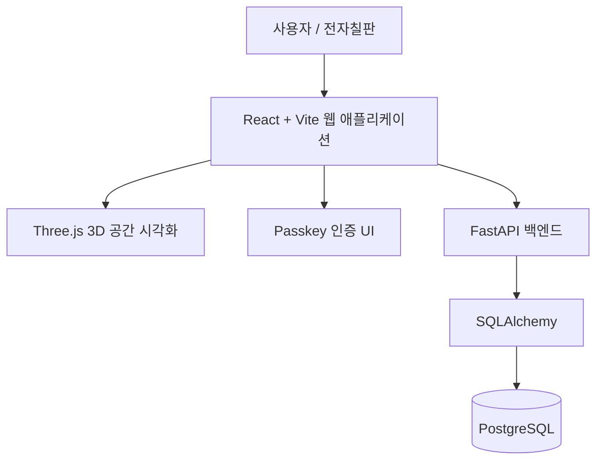

# AJOU SIGNAGE

### 3D 기반 캠퍼스 강의실 탐색 및 예약 사이니지 시스템

> **제2회 아주톤(AJOU Hackathon) | 아주대학교 성호관 강의실의 공간 탐색과 예약을 하나의 인터페이스로 연결하는 웹 서비스**

**프로젝트 시연 주소(발표 자료 기준):** https://pass.kksoft.kr:5173/  
※ 현재 서비스 운영 여부는 확인되지 않았습니다.

## 1. 프로젝트 소개

AJOU SIGNAGE는 기존 대학 포털의 복잡한 강의실 조회·예약 절차를 개선하기 위해 기획한 **3D 공간 시각화 및 강의실 예약 웹 애플리케이션**입니다. 아주대학교 **성호관**을 3D로 표현하고, 건물과 층별 강의실을 탐색하며 예약 현황을 확인할 수 있도록 설계했습니다. 강의실 내 전자칠판을 활용한 **디지털 사이니지** 사용 시나리오도 제시했습니다.

### 문제 정의

- 기존 포털에서는 강의실을 조회하기 위해 여러 메뉴와 조건을 순차적으로 선택해야 합니다.
- 강의실의 실제 위치와 예약 가능 여부를 직관적으로 파악하기 어렵습니다.
- 유휴 강의실을 학습·토론·동아리 활동에 활용하기 위한 접근성이 부족합니다.

### 프로젝트 목표

1. 성호관 공간을 **3D 디지털 트윈 형태**로 시각화하기
2. 기존 포털보다 직관적인 **강의실 탐색 및 예약 경험** 제공하기
3. 전자칠판과 웹을 연결해 **공간 정보 사이니지**로 활용하기

## 2. 주요 기능

### 2.1 3D 건물 및 층별 탐색

- 3D 모델을 활용한 성호관 공간 표현
- 층 선택 인터페이스를 통한 공간 탐색
- 건물 내부 강의실의 위치를 시각적으로 파악할 수 있는 UI

### 2.2 강의실 예약 인터페이스

- 선택한 강의실의 예약 정보 및 예약 입력 화면 제공
- 날짜·시간 등 예약 조건을 입력하는 인터페이스
- **Passkey** 기반 인증 방식 활용

### 2.3 강의실 현황 대시보드

- 강의실 사용 가능·사용 중 등 상태 확인
- 건물 및 강의실별 현황 조회
- 예약 관련 정보를 카드와 통계로 표시

### 2.4 건물·층·상태 필터

- 건물 및 층별 강의실 목록 필터링
- 강의실 상태별 조회
- 강의실별 상세 정보 접근

### 2.5 시간표 및 예약 관리

- 강의실별 시간표 조회
- 시간대별 예약 현황 표시
- 예약 신청 및 예약 정보 확인 UI

### 2.6 전자칠판 기반 사이니지 시연

- 실제 전자칠판에서 3D 탐색 웹 화면을 시연
- 교내 공간 정보와 예약 기능을 터치 디스플레이에서 활용하는 사용 시나리오 제시

## 3. 기술 스택

| 구분 | 기술 |
| --- | --- |
| Frontend | React, Vite |
| 3D Visualization | Three.js |
| Backend | FastAPI |
| ORM | SQLAlchemy |
| Database | PostgreSQL |
| Authentication | Passkey |
| Deployment / 운영 환경 | 발표 자료에 구체적인 배포 구성 미기재 |

## 4. 시스템 구성

아래는 발표 자료에 제시된 기술을 기반으로 정리한 **개념적 구성도**입니다. 실제 API 명세 및 배포 토폴로지는 별도 소스 코드 확인이 필요합니다.

## 5. 사용자 이용 흐름

1. 웹 서비스에 접속합니다.
2. 3D 건물 화면에서 원하는 층을 선택합니다.
3. 강의실을 선택해 현황 및 예약 정보를 확인합니다.
4. 필요 시 인증 절차를 진행하고 예약 정보를 입력합니다.
5. 강의실별 시간표와 예약 현황을 조회합니다.

## 6. 기대 효과

- **학습 공간 접근성 향상:** 유휴 강의실을 자율 학습 및 토론 공간으로 활용
- **공간 활용 효율화:** 강의실 현황을 쉽게 확인해 자원 활용도 향상 기대
- **교내 활동 활성화:** 동아리 행사 및 학생 활동을 위한 공간 탐색 부담 감소
- **사용자 경험 개선:** 2D 목록 중심 조회를 3D 시각화와 직관적인 예약 UI로 보완

> 위 내용은 프로젝트 발표에서 제시한 **기대 효과**이며, 실제 사용률 증가 등 정량 성과로 검증된 수치는 아닙니다.

## 7. 팀 구성

**2025 제2회 아주톤 · 3조**

김경수 · 김민교 · 박미소 · 주민찬

※ 개인별 세부 역할은 발표 자료에 기재되어 있지 않아 임의로 구분하지 않았습니다.

## 8. 참고 자료

- 프로젝트 발표 자료: `2025 아주톤.pdf`
- 발표 자료에 기재된 시연 URL: https://pass.kksoft.kr:5173/

---

**AJOU SIGNAGE** — 캠퍼스 공간을 더 쉽게 찾고, 확인하고, 활용하기 위한 3D 강의실 사이니지 프로젝트.
